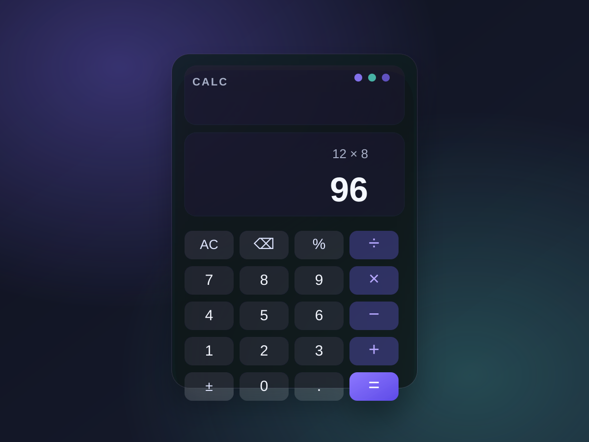

# morden-calculator-webapp

A modern calculator web app built with HTML, CSS, and JavaScript.

Created by: Showab Ahammad

## Preview

## Features
- Clean glassmorphism layout
- Responsive design
- Keyboard support
- Basic arithmetic operations

## Run locally
Open `index.html` in a browser.

## Files
- `index.html`
- `styles.css`
- `script.js`
